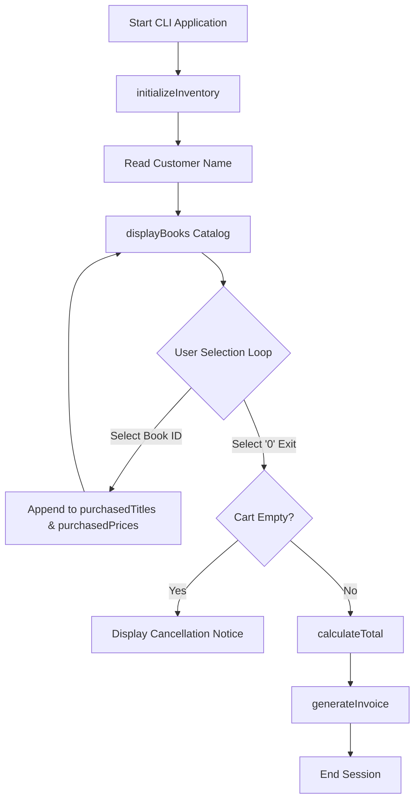

# 🏗️ Software Architecture Series

**Part 1: Procedural Baseline (Current Repo)** | [Part 2: OOP Migration](https://github.com/Sharaf-Ahmed-Dev/arch-2-oop) | [Part 3: SOLID Principles](https://github.com/Sharaf-Ahmed-Dev/arch-3-solid) | [Part 4: Design Patterns](https://github.com/Sharaf-Ahmed-Dev/arch-4-patterns)

---

### Software Architecture Series - Part 1: Procedural Baseline

## 📌 Overview

This repository contains the foundational procedural implementation of a Bookstore Management System written in Java. It serves as **Part 1 of a 4-part architectural refactoring series**, establishing a functional baseline CLI application built entirely using `static` methods, procedural control loops, and parallel data collections.

> [!NOTE]
> **Educational Intent:** This repository intentionally uses non-OOP procedural paradigms (global static state, parallel lists, tightly coupled I/O) to establish a measurable baseline before refactoring toward domain encapsulation, SOLID principles, and enterprise design patterns.

---

## 🔄 System Execution Flow



---

## 🛠️ Code Structure & Implementation Breakdown

The procedural logic is consolidated in a single execution file:

```text
arch-1-procedural/
├── src/
│   └── BookstoreProcedural.java   <-- Monolithic procedural implementation
└── README.md

```

### Key Functional Components

* **Parallel Data Collections:** Inventory attributes are stored across three synchronized static lists (`inventoryTitles`, `inventoryAuthors`, `inventoryPrices`).
* **State Management:** Session memory relies on global static variables (`currentCustomerName`, `purchasedTitles`, `purchasedPrices`).
* **Sequential Workflow:**
1. `initializeInventory()`: Populates in-memory catalog data.
2. `displayBooks()`: Formats available inventory into a tabular CLI interface.
3. `purchaseBooks()`: Handles interactive user selection and input validation.
4. `calculateTotal()`: Sums the prices in the purchase cart.
5. `generateInvoice()`: Prints a formatted receipt with a dynamic transaction ID.


---

## ⚖️ Architectural Trade-off Analysis

| Metric / Dimension | Level 1: Procedural Baseline | Target State (Level 4: Patterns) |
| --- | --- | --- |
| **Data Integrity** | ❌ High risk (Parallel arrays easily desynchronize) | ✅ Strong (Encapsulated immutable domain objects) |
| **State Management** | ❌ Global static variables (Thread unsafe) | ✅ Contextual / Injected session state |
| **Coupling & I/O** | ❌ High (Scanner / Print statements inside business logic) | ✅ Decoupled (Service interfaces & presenters) |
| **Testability** | ❌ Impossible to unit test isolated components | ✅ 100% Mockable via Dependency Injection |
| **Extensibility** | ❌ O(N) code changes required for new features | ✅ O(1) Open-Closed Principle adherence |

---

## ⚠️ Technical Debt & Bottlenecks

> [!WARNING]
> **Thread-Safety & Concurrency Hazard:** Declaring state variables as `static` prevents multi-threading and makes handling concurrent customer sessions impossible without severe data collisions.

1. **Parallel List Desynchronization Risk:** Data attributes are fragmented across three separate lists (`inventoryTitles`, `inventoryAuthors`, `inventoryPrices`). Modifying or sorting one list independently corrupts the dataset relationship.
2. **Tight Coupling of I/O and Business Logic:** Methods combine console input reading (`Scanner`), UI printing (`System.out.println`), and state mutation, preventing automated unit testing or adaptation to a web/GUI interface.
3. **Zero Extensibility:** Introducing new domain features (such as item discounts, tax tiers, or stock quantity tracking) requires modifying core execution loops, causing high cyclomatic complexity.

---

## 💻 Execution & Sample Output

### Prerequisites

* Java Development Kit (JDK 8 or higher)

### Build & Run Commands

```bash
# Navigate to source directory
cd src

# Compile application
javac BookstoreProcedural.java

# Run procedural CLI
java BookstoreProcedural

```

### Console Session Log

```text
======================================================================
              WELCOME TO THE BOOKSTORE MANAGEMENT SYSTEM           
======================================================================

Please enter the customer's name: zainy

----------------------------------------------------------------------
                        AVAILABLE BOOK COLLECTION                      
----------------------------------------------------------------------
ID    | Book Title                        | Author               | Price ($)
----------------------------------------------------------------------
1     | To Kill a Mockingbird            | Harper Lee           | $18.99  
2     | 1984                             | George Orwell        | $15.50  
3     | The Great Gatsby                 | F. Scott Fitzgerald  | $12.75  
4     | Dune                             | Frank Herbert        | $22.00  
...
13    | Clean Code                       | Robert C. Martin     | $45.99  
14    | Design Patterns                  | Erich Gamma          | $54.50  
15    | Head First Java                  | Kathy Sierra         | $42.80  
----------------------------------------------------------------------

Enter the Book ID you wish to purchase (1 - 15) or enter '0' when complete: 1
--> SUCCESS: Added "To Kill a Mockingbird" ($18.99) to cart.

Enter the Book ID you wish to purchase (1 - 15) or enter '0' when complete: 2
--> SUCCESS: Added "1984" ($15.50) to cart.

Enter the Book ID you wish to purchase (1 - 15) or enter '0' when complete: 4
--> SUCCESS: Added "Dune" ($22.00) to cart.

Enter the Book ID you wish to purchase (1 - 15) or enter '0' when complete: 1
--> SUCCESS: Added "To Kill a Mockingbird" ($18.99) to cart.

Enter the Book ID you wish to purchase (1 - 15) or enter '0' when complete: 0

======================================================================
                        BOOKSTORE TRANSACTION INVOICE                    
======================================================================
 Customer Name : zainy
 Transaction ID: BK-TXN-7715
----------------------------------------------------------------------
 PURCHASED ITEMS:
 #     | Book Title                                    | Price ($)
----------------------------------------------------------------------
 1     | To Kill a Mockingbird                         | $18.99  
 2     | 1984                                          | $15.50  
 3     | Dune                                          | $22.00  
 4     | To Kill a Mockingbird                         | $18.99  
----------------------------------------------------------------------
 TOTAL PURCHASE AMOUNT:                                    $75.48
======================================================================

======================================================================
Thank you for visiting our bookstore. We wish you a great reading journey. Goodbye!
======================================================================

```

---

## 🔄 Next Phase

To eliminate data fragmentation, global static state risks, and tight I/O coupling, **[Part 2: OOP Migration](https://github.com/Sharaf-Ahmed-Dev/arch-2-oop)** refactors this monolithic system into encapsulated domain objects (`Book`, `Purchase`, `Customer`) backed by formal UML class diagrams.
